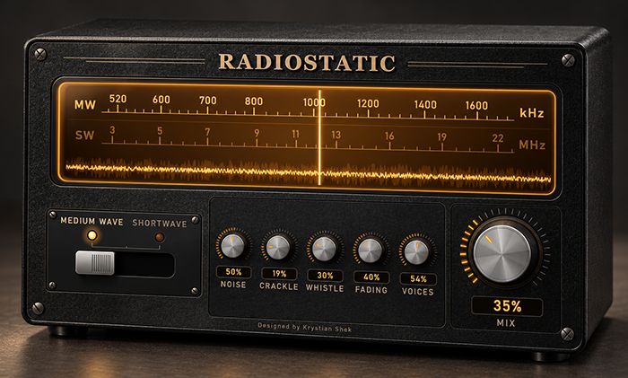

<div align="center">

# 📻 RadioStatic

### Crackle · Noise · Whistles · Fading · Radio Voices
**The medium wave & shortwave feeling as a VST3 effect plugin**

[](https://claude.ai)
[](#)
[](https://juce.com)
[](https://cmake.org)

*Designed by **Krystian Shek***

 

</div>

---

## ✨ What is RadioStatic?

RadioStatic sends your signal through an old radio – or rather, right into the middle of the
interference between two stations. You switch between **medium wave (MW)** and
**shortwave (SW)**, turn the **Mix** knob and decide for yourself how much chaos from the
airwaves gets added to your sound.

Perfect for lo-fi intros, film and radio drama atmospheres, spy vibes, a "numbers station" mood,
or simply to give an overly clean mix a bit of patina.

```
┌──────────────────────────────────────────────────────────────┐
│                        R A D I O S T A T I C                 │
│  ┌────────────────────────────────────────────────────────┐  │
│  │ MW  520   600   700   800  │ 1000  1200  1400  1600 kHz│  │
│  │ SW   3     5     7     9   │ 11   13    16   19   22 MHz│  │
│  │ ~~~~~~∿∿~~~~∿~~~/\~~∿∿~~~~~~~∿~~~~~/\/~~~~~∿∿~~~~~~~~~ │  │
│  └────────────────────────────────────────────────────────┘  │
│  ┌──────────────┐   ◯ NOISE  ◯ CRACKLE  ◯ WHISTLE  ◯ FADING │
│  │ MEDIUM  SHORT│   ◯ VOICES                       ┌───────┐ │
│  │ ●━━━━━━○     │                                  │  MIX  │ │
│  └──────────────┘                                  └───────┘ │
│                       Designed by Krystian Shek              │
└──────────────────────────────────────────────────────────────┘
```
<sub>Schematic illustration – the actual interface is a glowing glass dial with
metal knobs and LED rings in a retro look.</sub>

---

## 🎛️ Controls

| Control | Default | What it does |
|---|:---:|---|
| **MEDIUM WAVE / SHORTWAVE** | MW | Slide switch. Changes the character of the interference (see below). |
| **MIX** | 35 % | How much of the radio sound, including interference, is mixed into your signal. 0 % = clean, 100 % = fully on air. |
| **NOISE** | 50 % | Static noise – on shortwave with a swirling, wandering filter. |
| **CRACKLE** | 50 % | Crackles and atmospheric discharges, in bursts like a distant thunderstorm. |
| **WHISTLE** | 30 % | Heterodyne whistles from neighbouring stations that fade in and out and glide. |
| **FADING** | 40 % | Drop-outs in signal volume, as typical for far-away stations. |
| **VOICES** | 25 % | Chopped-up radio voices every now and then. Higher = more frequent and more heavily distorted transmissions. |

> 💡 **Tip:** Double-click a knob to reset it to its default value.
> The window can be resized freely.

### MW or SW?

| | 📡 Medium wave | 🌍 Shortwave |
|---|---|---|
| **Sound** | wider, more even | narrow-band, "further away" |
| **Noise** | constant | wandering, swirling |
| **Crackle** | frequent, in bursts | less frequent |
| **Whistles** | stable tones | wildly gliding tones |
| **Fading** | slow and gentle | fast and irregular |

### The display is alive

The needle on the dial wanders as if scanning for stations, and below it the interference
waveform runs live. The higher the mix, the wilder the swing.

---

## 🎙️ Radio Voices

The **VOICES** knob randomly plays short "transmissions" taken from an **embedded
voice recording** (`Resources/voice.wav`). The plugin automatically splits the recording into
sentences at the speech pauses and plays 1–3 of them per transmission. They are treated like
real radio traffic:

- 📞 Band-limited to the voice radio range (approx. 380–2600 Hz)
- 🔥 Heavy overdrive for that harsh, compressed radio sound
- 🧱 Sample rate crunch for grainy, digital transmission artefacts
- 🔔 *Squelch* click at the start and a "kshhk" at the end of every transmission
- 🌫️ Quietly hissing open carrier during the transmission
- 🌊 Fading brings the voices in and out

**Using your own voice:** Simply replace `Resources/voice.wav` with any WAV file of the same
name and rebuild the plugin. The sentences are detected again automatically.

---

## 🔧 Building from Source

### Requirements

- [CMake](https://cmake.org) 3.22 or newer
- A C++ compiler (Windows: Visual Studio with "Desktop development with C++", macOS: Xcode,
  Linux: GCC/Clang)
- [JUCE 8](https://github.com/juce-framework/JUCE) as a subfolder `JUCE/`

### Steps

```bash
# 1) Clone JUCE next to CMakeLists.txt
git clone https://github.com/juce-framework/JUCE.git

# 2) Configure
cmake -B build

# 3) Build
cmake --build build --config Release
```

You will then find the finished plugin at:

```
build/RadioStatic_artefacts/Release/VST3/RadioStatic.vst3
```

Copy the `.vst3` into your VST3 folder and have your DAW rescan for plugins:

| System | VST3 folder |
|---|---|
| Windows | `C:\Program Files\Common Files\VST3` |
| macOS | `/Library/Audio/Plug-Ins/VST3` |
| Linux | `~/.vst3` |

A **standalone** application is built as well, so you can try out the effect without a DAW.

---

## 🗂️ Project Structure

```
RadioStatic/
├── CMakeLists.txt            Build configuration (incl. embedded voice recording)
├── JUCE/                     JUCE framework (clone it yourself)
├── Resources/
│   └── voice.wav             embedded radio voice
└── Source/
    ├── PluginProcessor.h/.cpp   Sound: noise, crackle, whistles, fading, radio voices
    ├── PluginEditor.h/.cpp      Interface: layout and metal background
    └── UiComponents.h           Glass dial, slide switch, knobs with LED ring
```

### Tweaking the Sound

The most important parameters are located directly in the code in `PluginProcessor.cpp`:

- **Volume of the radio voices:** line with `chatLevel`
- **Character of MW and SW** (bandwidth, crackle density, fading speed): block at the beginning of `processBlock`
- **Pauses between transmissions:** function `next` in `RadioVoice` (`PluginProcessor.h`)

---

## 🛠️ Tech in Brief

- **Noise:** filtered white noise, with a wandering low-pass on SW
- **Crackle:** random impulses with a short decay, in thunderstorm-like bursts
- **Whistles:** two drifting sine oscillators with random fade-ins and fade-outs
- **Fading:** three superimposed slow modulators (irregular signal loss)
- **Radio sound:** band limiting with two high-pass and two low-pass filters plus gentle saturation
- **Display:** oscilloscope data and needle position are passed from the audio thread to the
  interface in a thread-safe way

---

## 🤖 Origin

This plugin was developed together with **[Claude](https://claude.ai)** by Anthropic:
all of the code (sound generation, interface and build system) was created in conversation
with Claude. The design is by **Krystian Shek**.

[](https://claude.ai)

---

## ⚠️ Notes

- The embedded voice recording was created with an AI voice generator. Before publishing or
  selling the plugin, check whether the license of your plan permits commercial use of the
  voice – or replace the recording with your own.
- The plugin is an effect for creative sound design. Start at low levels, as crackles and
  radio voices can get loud for brief moments.
- The source code is released under the MIT License – see [LICENSE](LICENSE).

---

<div align="center">

**RadioStatic** · Designed by Krystian Shek · Code written with Claude

*"Between the stations, that's where the magic is."*

</div>
